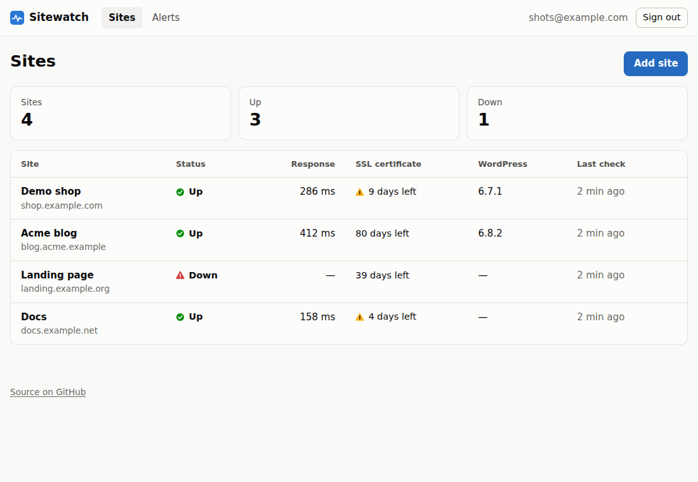
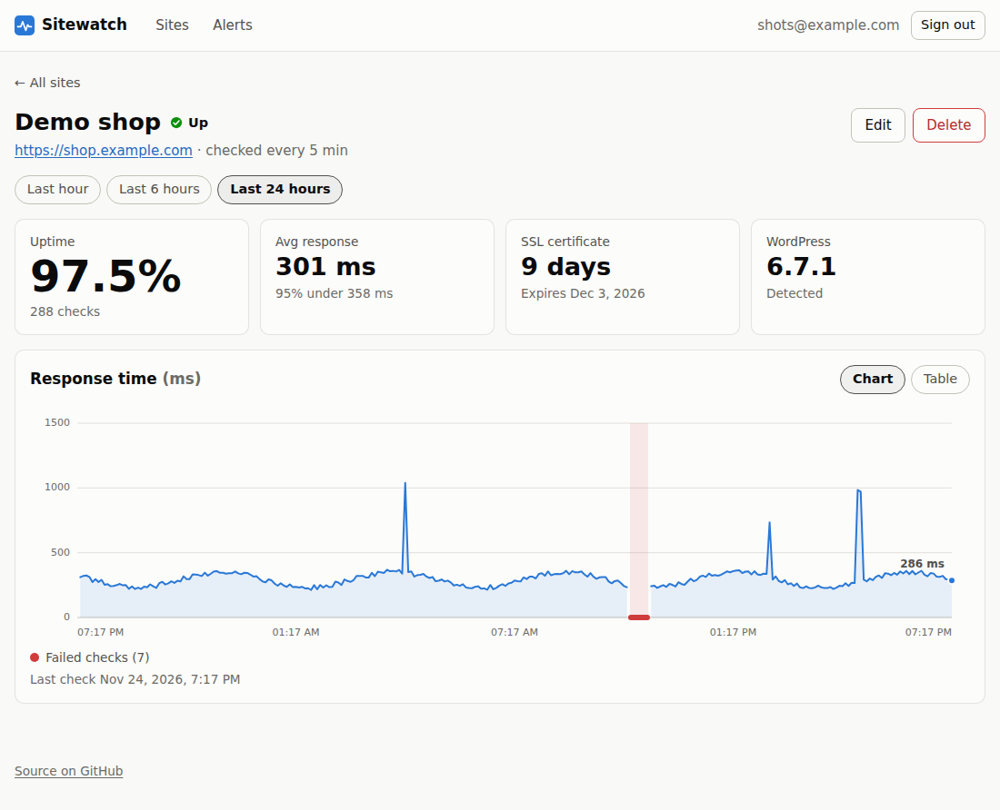

# Sitewatch

🇬🇧 English · 🇪🇸 [Español](README.es.md)

Website and WordPress monitoring: uptime, response time, SSL expiry and WordPress version, with alerts by email and Telegram.

**Live demo:** https://monitor.sergiomarin.dev — press **Try the demo** to sign in with a read-only account (sign-up is closed on the public demo).

## Stack
| Layer | Technology |
|---|---|
| Backend | Java 21, Spring Boot 4, Spring Security (JWT), Spring Data JPA, Flyway |
| Database | PostgreSQL 17 |
| Frontend | React 19, TypeScript, Vite |
| Tests | JUnit 5, Testcontainers, Vitest |
| CI/CD | GitHub Actions |
| Infrastructure | AWS EC2, Docker Compose, Terraform, Cloudflare (DNS + Pages) |
| Observability | Actuator, Micrometer, Prometheus, Grafana |

## Architecture


Everything fits on **one 1 GB EC2 t3.micro**: there are no separate workers or queues.

- **Panel and API:** the React panel is static on Cloudflare Pages. Calls to `/api` go through Cloudflare (TLS "Full (strict)") and Caddy to the Spring Boot API, which stores data in PostgreSQL.
- **Checks:** a `@Scheduled` job inside the API itself checks each site on virtual threads, with SSRF protection.
- **Alerts:** Telegram (Bot API) and email (Amazon SES).
- **Observability:** Grafana Alloy reads `/actuator/prometheus` inside the Docker network and ships it to Grafana Cloud.
- **Backups:** a systemd timer dumps PostgreSQL to S3 every night; the EC2 role can only write to the bucket.
- **Delivery:** every push to `main` is tested, built and deployed through SSM (no AWS keys stored in GitHub). Terraform defines AWS and Cloudflare, with its state in S3.

## Screenshots
| Site list | Detail with history |
|---|---|
|  |  |

*Demo data. The 35-minute outage is drawn as a band; dark theme and mobile are covered too ([dark screenshot](docs/screenshots/detail-dark.png)).*

## Local development
```bash
cp .env.example .env                                   # then fill in JWT_SECRET:
sed -i "s|^JWT_SECRET=.*|JWT_SECRET=$(openssl rand -base64 32)|" .env
docker compose up -d db                                # PostgreSQL
cd backend && set -a && . ../.env && set +a && ./mvnw spring-boot:run
cd frontend && npm install && npm run dev            # http://localhost:5173
```
Health check: http://localhost:8080/actuator/health

## API
Stateless authentication with JWT (HS256). Register and login return the token; every other endpoint requires it in the `Authorization: Bearer <token>` header. Errors follow the *problem details* format (RFC 9457).

| Method | Path | Description |
|---|---|---|
| `POST` | `/api/auth/register` | Creates the account and returns a token (`201`; `409` if the email already exists; `403` if sign-up is closed) |
| `POST` | `/api/auth/login` | Returns a token (`401` for invalid credentials; `429` after 5 failures in a row for the same email) |
| `GET` | `/api/auth/config` | What this deployment offers: `{"registrationOpen", "demoAvailable"}` |
| `POST` | `/api/auth/demo` | Token of the read-only demo account (`404` when there is no demo) |
| `POST` | `/api/auth/verify-email` | Confirms the email with the token from the link (`204`; `400` if it expired or was already used) |
| `GET` | `/api/auth/me` | The authenticated user |
| `GET` | `/api/sites` | The user's sites |
| `POST` | `/api/sites` | Adds a site (`name`, `url`, `checkIntervalMinutes` 5–1440 (default 5), `active`) |
| `GET` | `/api/sites/{id}` | Site detail |
| `PUT` | `/api/sites/{id}` | Replaces a site |
| `DELETE` | `/api/sites/{id}` | Deletes a site |
| `GET` | `/api/sites/{id}/checks?limit=50&since=<ISO>` | Check history, newest first (`limit` 1–500; `since` filters by date) |
| `GET` | `/api/checks/latest` | The latest check of every site, for the panel's list |
| `GET` / `PUT` | `/api/me/notifications` | Alert channels: `{"emailAlerts": true, "telegramChatId": "123456789"}` |
| `POST` | `/api/me/notifications/test` | Sends a test alert and reports the result per channel |
| `POST` | `/api/me/email-verification` | Sends the email confirmation link again (`429` if one was requested less than a minute ago) |

Every user only sees their own sites: someone else's site answers `404`, exactly like one that does not exist. Each user can monitor up to 10 sites.

```bash
TOKEN=$(curl -s -X POST localhost:8080/api/auth/register -H 'Content-Type: application/json' \
  -d '{"email":"demo@example.com","password":"supersecret1"}' | jq -r .accessToken)
curl -s -X POST localhost:8080/api/sites -H "Authorization: Bearer $TOKEN" -H 'Content-Type: application/json' \
  -d '{"name":"My blog","url":"https://example.com"}'
```

## How the checker works
Every 30 s a `@Scheduled` job looks for active sites whose interval has elapsed (column `last_checked_at`) and checks them on Java 21 virtual threads, at most 8 at a time. Each check stores a row in `site_check`:

- **Uptime and HTTP status:** follows up to 5 redirects; a status ≥ 400, a timeout, or a network or TLS error counts as down, with the reason in `error`.
- **Response time:** until the headers arrive.
- **SSL expiry:** the `notAfter` date of the certificate served over HTTPS. An expired or invalid certificate counts as down.
- **WordPress version:** the `<meta name="generator">` of the home page. If the site looks like WordPress (`/wp-content/`, `/wp-includes/` or the `Link` header for `api.w.org`) but hides its version, it tries `feed/`, `readme.html` and the core stylesheets that `wp-login.php` loads (`?ver=`), which security plugins rarely touch. These probes are cached for 12 h per site so they do not generate extra traffic or trigger plugins such as Wordfence.

**SSRF protection:** checks leave from the server, so a user could point a site at `localhost`, the private network or the AWS metadata service (`169.254.169.254`). The HTTP client (Apache HttpClient 5) uses its own `DnsResolver` that rejects any host resolving to a non-public address (loopback, private, link-local, CGNAT, ULA, NAT64 or 6to4 wrapping a private IPv4…). Because the client connects to exactly the validated addresses, the check also covers redirects and *DNS rebinding*.

History is deleted after 90 days (every night at 03:30), so the database does not grow without bound on a 1 GB instance.

Metrics at `/actuator/prometheus`: `sitewatch_checks_seconds{outcome="up|down"}` and `sitewatch_alerts_total{channel, type, result}`. Grafana Alloy reads them inside the Docker network (see below); the proxy answers `404` for that path from outside.

## Alerts
| Alert | When |
|---|---|
| 🔴 Down | After 2 failed checks in a row (a single failure does not alert). Once per incident |
| 🟢 Recovered | On the first successful check after a confirmed outage, with how long it lasted |
| 🟠 SSL about to expire | When less than 14 days are left. Once per certificate: if it is renewed and the new one is also close to expiring, it alerts again |

The state of each site (`UNKNOWN`, `UP` or `DOWN`) is stored in the `site` table, and alerts are sent after the transaction commits. If a channel fails, the error is logged and counted in the metrics, but it affects neither the check nor the other channels.

- **Email:** to the account's address, **once it is confirmed** with the link sent at sign-up (single use, expires after 24 h, and only its hash is stored). Until then nothing is sent to that address. Enabled by setting `SPRING_MAIL_HOST` (and a username and password if the SMTP server requires them). Locally, `docker compose up -d mailpit` collects every message at http://localhost:8025.
- **Telegram:** create a bot with [@BotFather](https://t.me/BotFather) and put its token in `TELEGRAM_BOT_TOKEN`. Each user opens a chat with the bot and saves their *chat id* at `/api/me/notifications`. The token is part of the Telegram API URL, so it is stripped from any error message before it reaches the logs.

## Public demo
The live instance is meant to be looked at, not used as a service:

- **Sign-up is closed** (`REGISTRATION_ENABLED=false`) and there is a **read-only** demo account (`DEMO_EMAIL`): its tokens carry a `readOnly` claim and a filter rejects every write (`403`), so the UI and the server agree.
- **Limits:** 10 sites per user, one check every 5 minutes at most, and a 15-minute lock after 5 failed sign-ins for the same email.
- **SES stays in the sandbox** on purpose: it can only write to verified addresses, so it cannot be used to email third parties.

## Observability and backups
- **Metrics:** Grafana Alloy (128 MB) reads the API every 60 s and writes to Grafana Cloud (free tier). The versioned dashboard is [`deploy/grafana/sitewatch-dashboard.json`](deploy/grafana/sitewatch-dashboard.json).
- **Backups:** `deploy/backup.sh` runs `pg_dump` and streams it through a pipe to S3 (the dump never touches the disk), every night at 03:00 UTC, kept for 30 days. The instance role can only add objects. Restoring is tested and documented in [`infra/terraform/README.md`](infra/terraform/README.md).
- **Budget:** an AWS Budgets alert (20 USD/month, only resources tagged `Project=sitewatch`) emails a warning.

## Deployment
Every push to `main` that passes CI is deployed automatically, with no AWS key stored in GitHub:

```
push → CI (tests, lint, terraform validate, shellcheck)
     → Docker image to GHCR (tag sha-<commit>)
     → GitHub gets short-lived AWS credentials through OIDC (from main only)
     → SSM Run Command runs deploy/deploy.sh on the EC2
          · fetches the compose file of the exact commit, refreshes secrets and the certificate from SSM
          · starts the new images and waits until they are healthy
          · if they are not, goes back to the previous version
     → checks /actuator/health through Cloudflare
     → builds the panel and uploads it to Cloudflare Pages
```
Traffic enters through Cloudflare (proxy, TLS "Full (strict)" with an origin certificate) and only Cloudflare can reach ports 80/443 of the EC2. Caddy terminates TLS and forwards to the API; metrics (`/actuator/prometheus`) are not exposed. Deployment stays off until the repository variable `DEPLOY_ENABLED` is `true`.

## Roadmap
- [x] Skeleton: backend, frontend, initial schema (Flyway), CI
- [x] Sign-up and login with JWT
- [x] CRUD of sites per user
- [x] Scheduled checker: uptime, response time, SSL, WordPress version
- [x] Alerts (email, Telegram)
- [x] React panel: login, site list, detail with response-time chart, and alert settings
- [x] Terraform (AWS and Cloudflare) and continuous deployment to EC2 and Pages
- [x] Prometheus + Grafana (Alloy → Grafana Cloud)
- [x] PostgreSQL backups to S3 and Terraform state in S3
- [x] Email verification, read-only public demo and usage limits
- [ ] Phase 2: vulnerable plugins (WPScan), public status page
